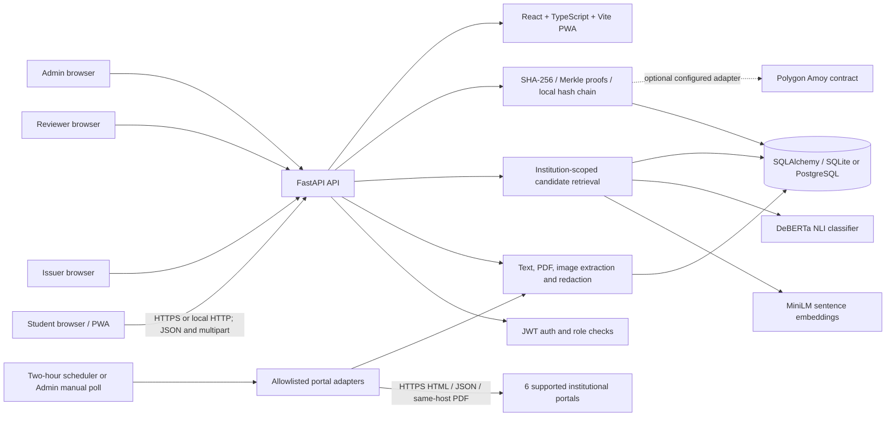
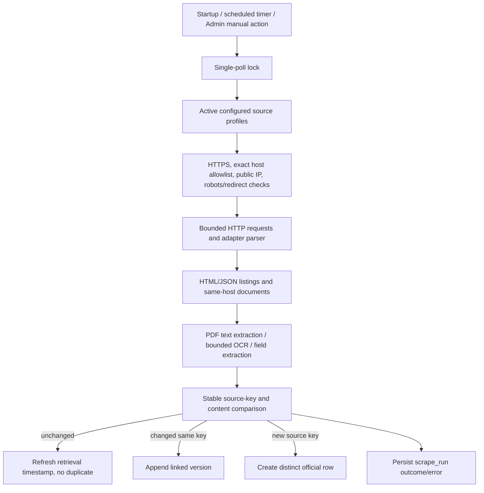
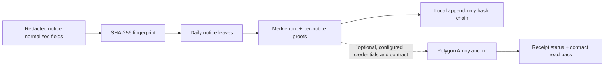

# FinalSay Technical Architecture

**Evidence snapshot:** 12 November 2026. Architecture reflects current source code, not an inferred deployment.

## System architecture



The frontend is a React single-page app with role-protected routes; it calls a same-origin `/api` path. In development Vite proxies `/api` to a configured FastAPI target. FastAPI creates ORM tables/migrations at startup and starts a background scrape scheduler when its interval is nonzero. SQLAlchemy stores users, institutions, notices, notice fields, source extraction sidecars, relation edges, review cases, benchmark records, source runs, Merkle proofs/roots and anchor blocks. SQLite is the local default; PostgreSQL is supported.

## Frontend architecture

- Entry/routing: `apps/web/src/main.tsx`, `App.tsx`, React Router.
- API client: Axios instance in `src/api/client.ts`; bearer JWT is stored in browser `localStorage` and attached by an interceptor.
- Auth context: `src/auth/AuthContext.tsx` handles register/login/me/logout.
- Role gate: `ProtectedRoute.tsx`, role-specific destinations in `App.tsx`.
- Student pages: submit, result, notices, alerts.
- Reviewer pages: queue, case resolution, blind benchmark and agreement view.
- Admin pages: source management and provenance.
- Issuer page: official notice publishing.
- Build: Vite, TypeScript, PWA plugin and static output under `apps/web/dist`.

There is no WebSocket layer. No persistent uploaded-file service is configured: uploaded bytes are read for processing, then redacted notice text/fields and optional extracted-text sidecars are stored.

## Backend architecture

`backend/finalsay/main.py` builds FastAPI, readiness/health routes, CORS, request timing logs, table/migration startup, and scheduled polling lifecycle. API modules separate auth, ingestion/source control, notice read/retrieval, comparison, issuer workflows, reviewer workflows, benchmark curation, and provenance. Services separate extraction, source ingestion, comparison/retrieval, scheduler, document extraction refresh, benchmark Kappa, and provenance. `adapters/live.py` contains typed public-site clients and per-portal parsers/adapters. No Selenium/Playwright/browser-rendered crawling, hosted LLM, or vector database is present.

### Main API routes

All paths are under `/api`. Authentication is bearer-token JWT unless noted.

| Method | Path | Purpose / access |
|---|---|---|
| GET | `/health`, `/health/ready` | Liveness and DB readiness; public |
| POST | `/auth/register` | Public student registration; returns user, not a token |
| POST | `/auth/login` | OAuth2 form login; returns JWT |
| GET | `/auth/me` | Current user; authenticated |
| POST | `/ingest/submit` | Student/admin text or PDF/image submit and compare |
| POST | `/compare/{submission_id}` | Re-run persisted comparison; student/admin and owner-scoped |
| GET | `/notices` | Current notice list; authenticated, submission visibility scoped |
| GET | `/notices/{notice_id}` | Notice detail, extracted fields and sidecars; access-scoped |
| GET | `/notices/{notice_id}/versions` | Same source-key version history |
| GET | `/notices/{submission_id}/candidates` | Ranked official candidates; submission owner/admin/reviewer scope |
| POST | `/ingest/fetch` | Manual source poll; Admin |
| GET/POST | `/ingest/sources` | List source profiles; create allowlisted profile (Admin for create) |
| PUT | `/ingest/sources/{institution_id}` | Update source configuration; Admin |
| GET | `/ingest/runs` | Recent scrape-run audit; Admin |
| GET | `/issuer/institutions` | Active granted institutions; Issuer |
| POST | `/issuer/publish` | Register official notice; Issuer with active institution grant |
| GET/POST | `/issuer-memberships` | List/grant issuer institution memberships; Admin |
| DELETE | `/issuer-memberships/{user_id}/{institution_id}` | Revoke issuer grant; Admin |
| GET | `/reviewer/queue` | Open review cases; Reviewer/Admin |
| POST | `/reviewer/cases/{case_id}/resolve` | Save reviewer resolution; Reviewer/Admin |
| GET | `/reviewer/benchmark/pairs` | Blind benchmark items; Reviewer |
| GET | `/reviewer/benchmark/status` | Per-reviewer completion status; Reviewer |
| POST | `/reviewer/benchmark/annotate` | Store account-scoped label; Reviewer |
| POST | `/reviewer/benchmark/complete` | Lock submitted corpus pass; Reviewer |
| GET | `/reviewer/benchmark/kappa` | Cohen's Kappa from overlapping completed account annotations |
| GET/POST | `/admin/benchmark/candidates`, `/admin/benchmark/pairs` | Curate real student/live-source pairs without model labels; Admin |
| POST | `/provenance/build` | Build a daily Merkle root; Admin |
| POST | `/provenance/retry/{root_id}` | Retry anchoring; Admin |
| GET | `/provenance/verify/{notice_id}` | Verify notice integrity; authenticated |

The full OpenAPI path list was generated from `create_app().openapi()`; framework documentation is served at `/docs` when the API is running.

### Role workflows

- **Student:** register (always receives student role), log in, select an active institution, submit pasted text/PDF/image, review comparison and candidate evidence, inspect notice versions/source/proof, and view alerts. Submission records are private to their owner except for Admin/Reviewer review access.
- **Issuer:** an operator provisions an issuer account; Admin grants the account a particular institution; the issuer sees active grants and publishes an official notice for an authorized institution. Publishing stores an official notice and builds/updates the daily local-or-configured Merkle root.
- **Reviewer:** a provisioned reviewer sees unresolved cases and can resolve them. In the blind benchmark, reviewers label their own copy of overlapping benchmark pairs, complete their pass, and the system calculates Cohen's Kappa only when two completed accounts share a corpus fingerprint.
- **Admin:** manages approved source profiles, polls sources, inspects run/error history, grants/revokes issuer memberships, curates real benchmark pairs without labels, and builds/retries/verifies provenance. These controls do not constitute a full user-management dashboard.

## Notice verification data flow

```mermaid
sequenceDiagram
  actor S as Student
  participant W as React PWA
  participant A as FastAPI
  participant X as Extraction/redaction
  participant R as Candidate retrieval
  participant M as MiniLM + DeBERTa
  participant D as SQLite/PostgreSQL
  S->>W: Paste text or upload PDF/image
  W->>A: POST /api/ingest/submit
  A->>X: Extract text, fields, redact PII
  X-->>A: Redacted content + fields
  A->>D: Persist submission and SHA-256
  A->>R: Search current official records in same institution
  R->>M: Embed/rank candidates
  M-->>R: Similarity/ranking scores
  R-->>A: Top candidate(s)
  A->>M: Classify relevant claim pair with NLI
  M-->>A: Relationship, score, rationale/evidence
  A->>D: Store relation edge; open review case if gated
  A-->>W: Result and candidate details
```

`services/comparison.py` retrieves up to top-K candidates (default 5), institution-scoped; semantic mode ranks current official notice text and sidecars. No separate manual search index or external vector database is required. A revision cue can prioritize explicitly titled same-topic revisions. `semantic_model.py` compares claim units using embedding similarity plus a DeBERTa NLI cross-encoder; if evidence/score is weak, the comparison service gates to unresolved. Confidence fields are model scores, not calibrated probabilities.

## Web-source ingestion flow



Repeated polling uses stable external IDs/source URLs and a partial unique index over current official `(institution_id, source_key)`. Same-key file bytes/content changes can append history. A new portal URL normally creates a separate notice; semantic matching may find it for comparison, but the ingestion layer does not infer a universal cross-URL identity.

## Provenance flow



Notice text and personal details remain off-chain. The on-chain interface is intended to hold root/batch/issuer identifiers and publisher/time metadata. The database stores proof JSON and anchor metadata. Current observed data is local-only.

## Database entities

| Entity/table | Purpose and key relationships |
|---|---|
| `user` | `id`, unique `email`, `hashed_password`, `role`, `display_name`, `created_at`; roles: student/reviewer/admin/issuer |
| `institution` | `id`, unique `slug`, `name`, `source_url`, `scrape_type`, `scrape_enabled`, `active` |
| `issuer_membership` | `user_id`, `institution_id`, `active`, `created_at`; unique user/institution grant |
| `notice` | `kind`, `institution_id`, `submitted_by`, `title`, dates, issuer/action/audience, redacted text, `source_url`, `source_key`, normalized/source SHA-256 values, `version_no`, `is_current`, `previous_version_id`, extraction quality, retrieval/creation timestamps |
| `notice_field` | `notice_id`, `field_name`, extracted `value`, extraction `confidence` |
| `notice_document_extraction` | `notice_id`, source URL, redacted extracted text and hash, method, quality, timestamp; not a source-version rewrite |
| `relation_edge` | source/destination notice IDs, label, confidence, rationale, model, status, creation time |
| `review_case` | edge ID, open/resolved status, assigned role, resolver, resolved label, timestamp |
| `benchmark_pair` | submission and official notice IDs, optional gold label and display snapshots |
| `benchmark_annotation` | pair ID, annotator user/account, label, timestamp |
| `benchmark_completion` | reviewer account, corpus fingerprint, completed state/time for fair Kappa comparison |
| `scrape_run` | institution ID, found/created/modified/unchanged counts, status/error, start/completion timestamps |
| `scrape_progress` | institution ID, backfill cursor/completion, update timestamp |
| `merkle_root` | day, root hash, anchor kind/reference, chain/network/contract/publisher/batch/block/time/status/error metadata |
| `merkle_proof` | notice/root IDs, proof JSON, leaf index |
| `anchor_block` | local chain index, previous hash, data hash, block hash, timestamp |

## Technology summary

| Technology | Purpose | Status |
|---|---|---|
| TypeScript, React 18, React Router, Vite | SPA/PWA UI and role workflows | Implemented; build passes |
| Python 3.11, FastAPI, Uvicorn | REST API and lifecycle/scheduler | Implemented; backend tests pass |
| SQLAlchemy 2, SQLite, PostgreSQL driver | ORM and persistence | Both supported; current DB is SQLite |
| Pydantic Settings | Environment-based configuration and production validation | Implemented |
| Axios, browser localStorage | API client and bearer JWT storage | Implemented |
| Passlib/bcrypt, python-jose/JWT | Password hashes and HS256 tokens | Implemented |
| `sentence-transformers`, MiniLM, Transformers, DeBERTa NLI, PyTorch | Semantic retrieval and pair classification | Implemented locally; no hosted LLM |
| Python `urllib`, HTMLParser, JSON parsing | Bounded typed scraping | Implemented for six adapter types |
| pypdf, PyMuPDF, Pillow, pytesseract/Tesseract | PDF extraction and image/scanned PDF OCR | Implemented; OCR engine/language packs environment-dependent |
| Solidity 0.8.24, Foundry, Web3.py | Root anchor contract, local tests and optional Amoy backend | Contract/backend implemented; no public deployment evidenced |
| Docker, Docker Compose, GitHub Actions, AWS ECS/Fargate templates | Container/deployment automation | Configuration present; hosted deployment not established |
| pytest, HTTPX, Foundry tests | Automated verification | 202 backend tests and 4 contract tests pass in current check |
